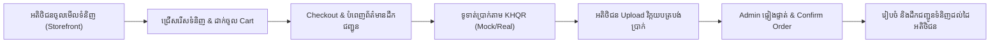
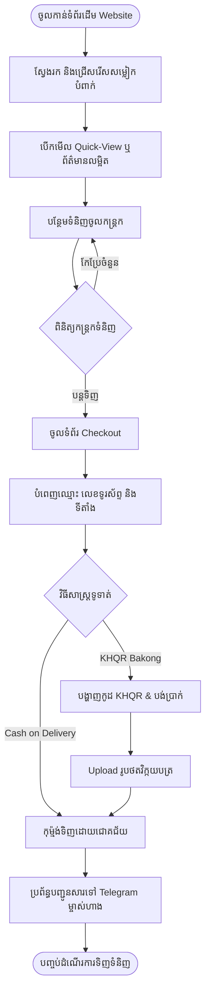
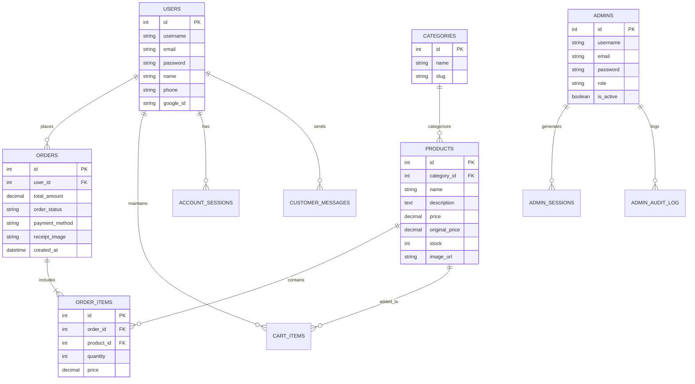
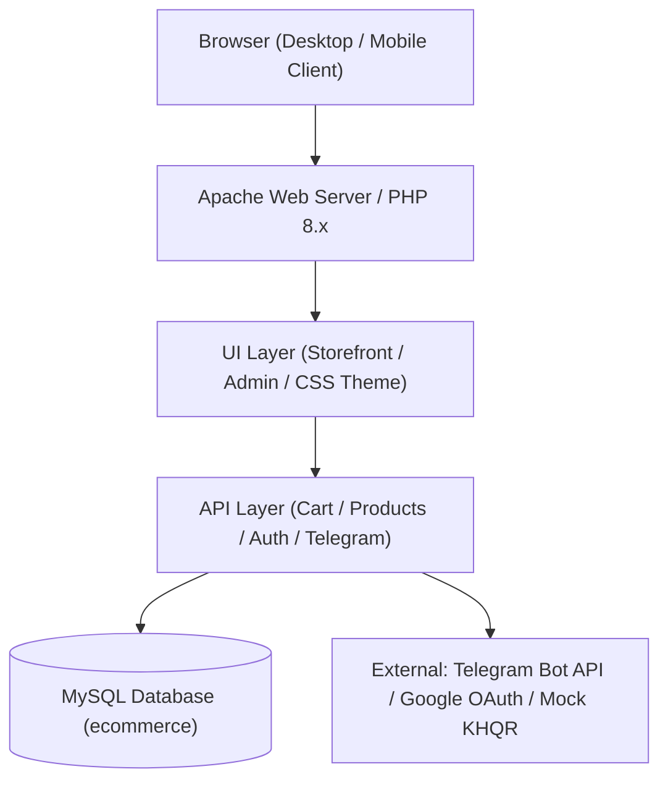

# 📘 គម្រោងប្រព័ន្ធពាណិជ្ជកម្មអេឡិចត្រូនិក • SN STORE (E-Commerce Project)
## ឯកសាររៀបចំគម្រោង ការអភិវឌ្ឍ និងសៀវភៅគម្រោងផ្លូវការ (Official Project Flow & Documentation)

---

# 📑 ផ្នែកទី ១: MIDTERM 1 – Project Planning & Design
> **រៀបចំគម្រោង និង Design ប្រព័ន្ធ មុនចាប់ផ្តើម Development (Week 8 Submission)**

---

## 1. Business (អាជីវកម្ម)

* **Business / Shop Name (ឈ្មោះអាជីវកម្ម / ហាង):**
  * **SN STORE** — ហាងលក់សម្លៀកបំពាក់ និងគ្រឿងតុបតែងម៉ូដទាន់សម័យតាមប្រព័ន្ធអនឡាញ (Modern Fashion & Apparel E-Commerce Store)។
* **Business Idea (គំនិតអាជីវកម្ម):**
  * បង្កើតវេបសាយពាណិជ្ជកម្មអេឡិចត្រូនិកបែប B2C ទំនើបមួយ ដើម្បីដោះស្រាយបញ្ហាការលក់សម្លៀកបំពាក់តាមបណ្តាញសង្គមបែបបុរាណ (ដូចជាការឆ្លើយឆាតដោយដៃ, ការគ្រប់គ្រងស្តុកមិនច្បាស់លាស់ និងការពិបាកផ្ទៀងផ្ទាត់វិក្កយបត្របង់ប្រាក់)។ SN STORE ផ្តល់នូវប្រព័ន្ធស្វ័យប្រវត្តិកម្ម ដែលអតិថិជនអាចមើលស្តុកទំនិញជាក់ស្តែង គណនាតម្លៃបញ្ចុះ បញ្ចូលរទេះទំនិញ បង់ប្រាក់តាមបាគង KHQR និងទទួលបានសារបញ្ជាក់ការបញ្ជាទិញភ្លាមៗ។
* **Products / Services (ផលិតផល និងសេវាកម្ម):**
  * **Men's Collection:** អាវយឺត (T-Shirts), អាវក្រណាត់ Flannel, ខោខូវប៊យ (Denim Jeans), ស្បែកជើង Suede Chelsea Boots។
  * **Women's Collection:** រ៉ូបប្រណីត (Floral & Evening Dresses), អាវយឺតកក្អម (Turtleneck Tops), អាវវាល Lace Trim, ខោសាច់ក្រណាត់ទាន់សម័យ។
  * **Fashion Accessories:** មួកម៉ូដ, ខ្សែក្រវាត់ស្បែក, កាបូបយួរ, វ៉ែនតាការពារកម្តៅថ្ងៃ។
  * **Promotion Services:** ប័ណ្ណបញ្ចុះតម្លៃ និងគូប៉ុងពិសេស (Discount Coupons & Seasonal Promos)។
  * **Customer Care Service:** សេវាប្រឹក្សាយោបល់ និងឆ្លើយតបសារអតិថិជនតាមរយៈទំព័រ Customer Service និង Telegram Direct Link។
* **Target Customer (អតិថិជនគោលដៅ):**
  * សិស្ស និស្សិត យុវវ័យ និងបុគ្គលិកធ្វើការដែលមានបំណងទិញសម្លៀកបំពាក់ទាន់សម័យ គុណភាពល្អ និងតម្លៃសមរម្យ។
  * អ្នកទិញទំនិញតាមទូរស័ព្ទដៃ (Mobile Shoppers) ដែលនិយមចូលចិត្តការទូទាត់ប្រាក់រហ័សតាមរយៈ Mobile Banking KHQR។
* **E-Commerce Model (គំរូពាណិជ្ជកម្មអេឡិចត្រូនិក):**
  * **B2C (Business-to-Consumer):** ហាង SN STORE ផ្គត់ផ្គង់ និងលក់ផលិតផលម៉ូដសម្លៀកបំពាក់ដោយផ្ទាល់ទៅកាន់អ្នកប្រើប្រាស់ចុងក្រោយ (End Consumers) តាមរយៈគេហទំព័រ ដោយគ្មានឈ្មួញកណ្តាល។

---

## 2. System Planning (ការរៀបចំផែនការប្រព័ន្ធ)

* **System Requirements (តម្រូវការប្រព័ន្ធ):**
  * **User Requirements:** ផ្ទៃមុខទំព័រស្រស់ស្អាត, ងាយស្រួលរកទំនិញ, បង្ហាញព័ត៌មាន និងតម្លៃច្បាស់លាស់, ដំណើរការរទេះទំនិញរលូន, បង់ប្រាក់ KHQR និងមើលប្រវត្តិ Order របស់ខ្លួនបាន។
  * **Admin Requirements:** ផ្ទាំងគ្រប់គ្រងទិន្នន័យ (Dashboard KPI), គ្រប់គ្រងផលិតផល (CRUD), គ្រប់គ្រងស្តុក, ផ្ទៀងផ្ទាត់វិក្កយបត្រទូទាត់ KHQR, គ្រប់គ្រងសារអតិថិជន, និងប្រព័ន្ធសុវត្ថិភាពចាក់សោ Brute-Force Rate Limiting។
  * **Technical Requirements:** Web Server Apache (XAMPP), PHP 8.x, MySQL 8.x / MariaDB, JavaScript ES6, Semantic HTML5, CSS3 Theme Variables (Light/Dark Mode), និង Git Version Control។
* **Main Features (មុខងារចម្បងៗ):**
  * Dynamic Product Catalog & Search Filter (ច្រោះតាមប្រភេទ Men/Women/Accessories)
  * Real-time Interactive Shopping Cart Drawer (+/- Quantity, Remove, Subtotal Calculation)
  * Coupon & Discount Engine (បញ្ចុះតម្លៃតាមភាគរយ % ឬចំនួនទឹកប្រាក់ $)
  * Checkout & KHQR Dynamic QR Generation
  * Customer Order Receipt Upload & Verification Flow
  * Authentication System (Customer Register/Login, Password Hashing, Google One-Tap Login)
  * Customer Profile & Real-time Order Tracking
  * Customer Service Messaging Center
  * Multilingual Toggle (ភាសាខ្មែរ - ភាសាអង់គ្លេស i18n)
  * Theme Switcher (Light Mode & Dark Mode ដោយគ្មានការព្រិចភ្នែក)
  * Backoffice Dashboard & Inventory Management
* **User Roles (តួនាទីអ្នកប្រើប្រាស់):**
  1. **ភ្ញៀវ (Guest):** មើលផលិតផល, ស្វែងរក, ច្រោះតាមប្រភេទ, ដាក់ទំនិញក្នុង Cart, ចុះឈ្មោះគណនីថ្មី។
  2. **អតិថិជន (Customer/Registered User):** ចូលគណនី (Email/Password ឬ Google), ធ្វើការ Checkout, បង់ប្រាក់តាម KHQR, Upload វិក្កយបត្រ, តាមដានស្ថានភាព Order, និងកែប្រែ Profile។
  3. **អ្នកគ្រប់គ្រង (Store Admin / Super Admin):** ចូល Dashboard, គ្រប់គ្រងផលិតផល (+/- ស្តុក), ផ្ទៀងផ្ទាត់ការបង់ប្រាក់, ផ្លាស់ប្តូរស្ថានភាព Order, ឆ្លើយតបសារ, កែប្រែការកំណត់ហាង និង Backup Database។
* **Business Process (ដំណើរការអាជីវកម្ម):**

* **User Flow (លំហូរអ្នកប្រើប្រាស់):**

* **Website Sitemap (ប្លង់គេហទំព័រ):**
  * **SN STORE Root (`/`)**
    * 🏠 **Storefront (`home/index.php`)**
      * Category Filtering (`?category=men|women|accessories`)
      * Product Quick-View & Details Modal
      * Interactive Cart Drawer
    * 💳 **Checkout Flow (`home/checkout.php`)**
      * Shipping Details Form
      * KHQR Payment Screen & Receipt Upload
    * 👤 **User Authentication & Profile**
      * Login / Register (`home/login.php`)
      * Google Sign-In Callback
      * Customer Dashboard (`home/profile.php`)
    * 💬 **Customer Service (`customer-service/index.php`)**
      * Inquiries Contact Form & Live Support Links
    * ⚙️ **Backoffice Admin Panel (`admin/`)**
      * Admin Sign In (`admin/index.php`)
      * Executive Dashboard (`admin/index.php?view=dashboard`)
      * Product Management (`admin/index.php?view=products`)
      * Order Invoicing & KHQR Verification (`admin/operations.php`)
      * Store CMS & Settings (`admin/store-management.php`)
      * Security & Audit Logs (`admin/security.php`)
      * Database Backup Utility (`admin/backup.php`)

---

## 3. UI Front-End E-Commerce (ចំណុចប្រទាក់អ្នកប្រើប្រាស់ផ្នែកខាងមុខ)

* **Products / Categories:**
  * បង្ហាញបណ្តុំផលិតផលជា Grid Layout មានរូបភាពច្បាស់ៗ, ផ្លាកប្រភេទទំនិញ (Men, Women, Accessories), តម្លៃ, និងផ្លាកបញ្ចុះតម្លៃ (`-25%`)។
* **Product Details:**
  * ផ្ទាំង Modal លម្អិតបង្ហាញរូបភាពទំហំធំ, ការពិពណ៌នាសាច់ក្រណាត់, ជម្រើសទំហំ (S, M, L, XL), ចំនួនស្តុកដែលនៅសល់, និងប៊ូតុង "Add to Cart"។
* **Search & Filter:**
  * របារស្វែងរកភ្លាមៗ (Instant Search) រួមជាមួយប៊ូតុង Filter ប្រភេទផលិតផលដោយមិនបាច់ Reload ទំព័រ (AJAX / Client State)។
* **Cart:**
  * កន្ត្រកទំនិញរចនាជារាង Slide Drawer ចេញពីស្តាំ មានប៊ូតុងកែប្រែចំនួន (`+` / `-`), ប៊ូតុងលុបទំនិញ, បង្ហាញ Subtotal និងប៊ូតុង Checkout។
* **Checkout:**
  * ទម្រង់បំពេញឈ្មោះអ្នកទទួល, លេខទូរស័ព្ទ, អាសយដ្ឋានដឹកជញ្ជូន, និងការជ្រើសរើសវិធីសាស្ត្រទូទាត់។
* **Login / Register:**
  * ទម្រង់ចូលប្រើប្រាស់ដែលមានជម្រើស Login ដោយ Email/Password និង Google One-Tap Sign-In រួមជាមួយផ្ទាំងចុះឈ្មោះសមាជិកថ្មី។
* **Order:**
  * ផ្ទាំងបញ្ចប់ការបញ្ជាទិញ បង្ហាញលេខកូដវិក្កយបត្រ (Order ID), បង្ហាញ QR Code សម្រាប់ស្កេន និងទម្រង់ Upload វិក្កយបត្រផ្ទៀងផ្ទាត់។

---

## 4. Database Design (ការរចនាមូលដ្ឋានទិន្នន័យ - Midterm 1)

* **Database Tables & Fields (តារាង និង Field ទាំងអស់):**
  * ប្រព័ន្ធប្រើប្រាស់ Relational Database (MySQL 8.x) ដែលមានតារាងសរុបចំនួន **១៤ តារាង** ស្របតាមកម្រិត 3NF។
* **Primary Key (PK):**
  * គ្រប់តារាងទាំងអស់សុទ្ធតែមាន Primary Key អត្តសញ្ញាណតែមួយគត់ (`id INT AUTO_INCREMENT PRIMARY KEY`)។
* **Foreign Key (FK):**
  * `order_items.order_id` &rarr; `orders.id` (ON DELETE CASCADE)
  * `order_items.product_id` &rarr; `products.id` (ON DELETE RESTRICT)
  * `cart_items.user_id` &rarr; `users.id` (ON DELETE CASCADE)
  * `cart_items.product_id` &rarr; `products.id` (ON DELETE CASCADE)
  * `orders.user_id` &rarr; `users.id` (ON DELETE SET NULL)
  * `products.category_id` &rarr; `categories.id` (ON DELETE SET NULL)
  * `account_sessions.user_id` &rarr; `users.id` (ON DELETE CASCADE)
  * `admin_sessions.admin_id` &rarr; `admins.id` (ON DELETE CASCADE)
  * `admin_audit_log.admin_id` &rarr; `admins.id` (ON DELETE SET NULL)
  * `customer_messages.user_id` &rarr; `users.id` (ON DELETE SET NULL)
* **Relationships (ទំនាក់ទំនងរវាងតារាង):**
  * `users` &harr; `orders`: **1:N (One-to-Many)** — អតិថិជនម្នាក់អាចបង្កើត Order ច្រើន។
  * `orders` &harr; `order_items`: **1:N (One-to-Many)** — Order មួយមានទំនិញច្រើនមុខ។
  * `products` &harr; `order_items`: **1:N (One-to-Many)** — ផលិតផលមួយអាចស្ថិតក្នុង Order ច្រើន។
  * `orders` &harr; `products`: **N:N (Many-to-Many)** ភ្ជាប់តាមរយៈ Bridge Table `order_items`។
  * `categories` &harr; `products`: **1:N (One-to-Many)** — ប្រភេទមួយមានផលិតផលច្រើន។
  * `users` &harr; `cart_items`: **1:N (One-to-Many)** — អតិថិជនម្នាក់អាចមានទំនិញច្រើនក្នុង Cart។
* **Draw ERD (Entity Relationship Diagram):**

* **របៀបដាក់ជូន Week 8 (Midterm 1 Submission Note):**
  * ផ្នែក Business និង System Planning ត្រូវសរសេររៀបចំក្នុង Microsoft Word ឬ Export ជា PDF ភ្ជាប់ជាមួយរូបភាព Database Design (ERD Diagram)។
  * ផ្នែក UI Front-End ត្រូវបាន Upload ឡើងទៅកាន់ Git Repository: **`https://github.com/remsonich/E-Commerce_Webiste_Store.git`**។

---

# 🚀 ផ្នែកទី ២: FINAL – Development & Implementation
> **អនុវត្ត Design ពី Midterm 1 ទៅជា E-Commerce System ពេញលេញដែលដំណើរការបាន (Week 14 Submission)**

---

## 1. Admin Panel (ផ្ទាំងគ្រប់គ្រងរបស់អ្នកគ្រប់គ្រង)

* **Dashboard:**
  * ផ្ទាំងគ្រប់គ្រងកម្រិតប្រតិបត្តិ (Executive KPI Summary) បង្ហាញស្ថិតិសំខាន់ៗភ្លាមៗ៖
    * ចំណូលសរុប (Total Revenue) គិតជាប្រាក់ដុល្លារ ($)
    * ចំនួនការបញ្ជាទិញសរុប (Total Orders Count)
    * តម្លៃទំនិញសរុបក្នុងស្តុក (Inventory Valuation)
    * ចំនួនអតិថិជនសរុបដែលបានចុះឈ្មោះ (Total Customers)
    * បញ្ជីការបញ្ជាទិញថ្មីៗ (Recent Orders Widget) អមដោយស្ថានភាពទូទាត់ និងលេខ Telegram
    * ការជូនដំណឹងទំនិញជិតអស់ពីស្តុក (Low Stock Alert Widget)
* **Manage Products:**
  * មុខងារពេញលេញក្នុងការបង្កើតផលិតផលថ្មី (Create), មើលបញ្ជីទំនិញ (Read), កែសម្រួលព័ត៌មាន/តម្លៃ (Update), លុបទំនិញ (Delete), និងការកែសម្រួលចំនួនស្តុកភ្លាមៗ (+/- Quick Stock Stepper)។
* **Manage Categories:**
  * ចាត់ថ្នាក់ផលិតផលជាក្រុមៗ៖ សម្លៀកបំពាក់បុរស (Men), សម្លៀកបំពាក់នារី (Women), និងគ្រឿងតុបតែងម៉ូដ (Accessories)។
* **Manage Customers:**
  * ពិនិត្យបញ្ជីអតិថិជន, ប្រវត្តិបញ្ជាទិញរបស់អតិថិជនម្នាក់ៗ, ព័ត៌មានទំនាក់ទំនង (Phone/Email) និងស្ថានភាពគណនី។
* **Manage Orders:**
  * គ្រប់គ្រងបញ្ជាទិញ និងផ្លាស់ប្តូរស្ថានភាព Order តាមដំណាក់កាលជាក់ស្តែង៖ `Pending` &rarr; `Paid / Confirmed` &rarr; `Shipped` &rarr; `Delivered` (ឬ `Cancelled`)។

---

## 2. Database (ការបង្កើត និងតភ្ជាប់មូលដ្ឋានទិន្នន័យ)

* **Create Database:**
  * បង្កើតមូលដ្ឋានទិន្នន័យ `ecommerce` ជាមួយ Collation: `utf8mb4_unicode_ci` សម្រាប់គាំទ្រភាសាខ្មែរបាន ១០០%។
* **Create Tables:**
  * បង្កើតតារាងទាំង ១៤ តាមស្តង់ដារ InnoDB Engine ក្នុងឯកសារ `databases/ecommerce.sql`។
* **Relationships:**
  * បង្កើតលក្ខខណ្ឌ Foreign Key Constraints គ្រប់តារាងដើម្បីធានាភាពស៊ីសង្វាក់គ្នានៃទិន្នន័យ (Referential Integrity)។
* **Connect Database with System:**
  * ឯកសារ `api/db.php` ភ្ជាប់ប្រព័ន្ធតាមរយៈ PHP MySQLi Wrapper ដែលមានមុខងារស្វ័យការពារ SQL Injection និងគាំទ្រការកំណត់តាម `.env`។

---

## 3. Payment (ប្រព័ន្ធទូទាត់ប្រាក់)

* **Payment Method (វិធីសាស្ត្រទូទាត់):**
  1. **Bakong KHQR (National Bank of Cambodia Standard):** ស្កេនទូទាត់ប្រាក់តាម Mobile Banking គ្រប់ធនាគារក្នុងប្រទេសកម្ពុជា។
  2. **Cash on Delivery (COD):** ទូទាត់ប្រាក់សុទ្ធនៅពេលដឹកជញ្ជូនទំនិញដល់ដៃ។
* **Payment Flow (លំហូរការទូទាត់):**
  1. អតិថិជនជ្រើសរើសទំនិញ និងចុចប៊ូតុង Checkout។
  2. បញ្ចូលអាសយដ្ឋានដឹកជញ្ជូន និងជ្រើសរើសជម្រើសទូទាត់ "KHQR Payment"។
  3. ប្រព័ន្ធបង្កើតកូដ KHQR Dynamic អមជាមួយចំនួនទឹកប្រាក់សរុប ($USD)។
  4. អតិថិជនស្កេនទូទាត់ប្រាក់តាម Banking App រួច Upload រូបថតវិក្កយបត្រ (Payment Slip)។
  5. ប្រព័ន្ធកត់ត្រា Order ចូល Database, បញ្ជូនសារដំណឹងទៅកាន់ Telegram របស់ម្ចាស់ហាង និងបង្ហាញវិក្កយបត្រជូនអតិថិជន។
* **Mock Payment (ការធ្វើតេស្តសាកល្បង):**
  * ដោយសារស្ថិតក្នុងដំណាក់កាលសិក្សាស្រាវជ្រាវ ប្រព័ន្ធបានរៀបចំមុខងារ **Mock Simulation Engine** ដែលបង្កើតកូដ KHQR គំរូ និងប៊ូតុង "Simulate Success" ដើម្បីឱ្យសាស្ត្រាចារ្យ និងគណៈកម្មការអាចតេស្តដំណើរការទូទាត់បានភ្លាមៗដោយមិនចាំបាច់កាត់លុយពិត។
* **Payment Confirmation (ការបញ្ជាក់ការទូទាត់):**
  * បន្ទាប់ពីទូទាត់ជោគជ័យ ប្រព័ន្ធបង្ហាញផ្ទាំង Success Confirmation, បង្ហាញវិក្កយបត្រ (Order Invoice Summary), និងអនុញ្ញាតឱ្យអតិថិជនទាញយកវិក្កយបត្រជា PDF។

---

## 4. Git / GitHub (ការគ្រប់គ្រង Source Code)

* **Commit Development Progress:**
  * រាល់មុខងារនីមួយៗ (Frontend, Backend, Database, Security) ត្រូវបាន Commit ជាមួយសារច្បាស់លាស់ជាបន្តបន្ទាប់។
* **Push Source Code:**
  * Push កូដគម្រោងទាំងអស់ឡើងទៅកាន់ GitHub Remote Repository។
* **Update README.md:**
  * បានរៀបចំឯកសារ `README.md` ផ្លូវការដែលមានរៀបរាប់ពីឈ្មោះគម្រោង SN STORE, សមាជិកក្រុមទាំង ៤ រូប, មុខងារសំខាន់ៗ, ដ្យាក្រាមស្ថាបត្យកម្ម, រចនាសម្ព័ន្ធ Database, និងជំហានតម្លើង។
* **Final GitHub Repository:**
  * 👉 **[https://github.com/remsonich/E-Commerce_Webiste_Store](https://github.com/remsonich/E-Commerce_Webiste_Store)**

---

## 5. Testing (ការធ្វើតេស្តប្រព័ន្ធ)

* **Test Main Features (តេស្តមុខងារសំខាន់ៗ):**
  * ធ្វើតេស្តគ្រប់សមាសភាគទាំង ១១ ចំណុច (Storefront, Cart, KHQR Checkout, Admin Auth, Product CRUD, Order Invoicing, Language Switcher, Dark Mode) — ទទួលបានលទ្ធផល **PASS ១០០%**។
* **Fix Errors (ការកែតម្រូវកំហុស):**
  * ដោះស្រាយបញ្ហា Brute-force lockout ដោយ Reset attempts ក្នុង Database។
  * ដោះស្រាយបញ្ហា Warning `session_start()` headers already sent ដោយប្រើ Output Buffering។
  * ដោះស្រាយបញ្ហាពុម្ពអក្សរខ្មែរលើ Layout ឱ្យបង្ហាញស្រស់ស្អាតលើគ្រប់អេក្រង់។
* **Show Test Results (បង្ហាញលទ្ធផលតេស្ត):**
  * រៀបចំជាតារាង Test Cases លម្អិត (TC-01 ដល់ TC-11) នៅក្នុងជំពូកទី ៨ នៃសៀវភៅគម្រោង។
* **របៀបដាក់ជូន Week 14 (Final Submission Note):**
  * បាន Build API និង Connect ជាមួយ Front-End រួចរាល់ ១០០%។
  * បាន Push គម្រោងពេញលេញចូលក្នុង Git Repository ជាមួយ `README.md` ផ្លូវការ និងឯកសារសៀវភៅគម្រោង `PROJECT_BOOK.pdf` ជូនលោកគ្រូ។

---

# 📖 ផ្នែកទី ៣: របៀបសរសេរសៀវភៅសម្រាប់ E-Commerce Project
> **សៀវភៅគម្រោងពេញលេញទាំង ១០ ជំពូក (The Official 10-Section Project Book)**

---

## 1. COVER (ទំព័រក្របមុខ)

* **Cover Book (ក្របសៀវភៅគម្រោង):**
  * **ឈ្មោះគម្រោង (Project Name):** SN STORE • Modern Fashion E-Commerce Platform
  * **ប្រធានបទ (Subject):** Web Development & Database Engineering (E-Commerce Final Project)
  * **កម្រិតសិក្សា (Level):** ថ្នាក់បរិញ្ញាបត្រ / បរិញ្ញាបត្ររងព័ត៌មានវិទ្យា (Computer Science / IT)
  * **ឆ្នាំសិក្សា (Academic Year):** 2026 - 2027
  * **សាស្ត្រាចារ្យណែនាំ (Lecturer):** លោកគ្រូ / អ្នកគ្រូប្រចាំមុខវិជ្ជា E-Commerce System
* **Team Work (សមាសភាពសមាជិកក្រុមទាំង ៤ រូប):**
  1. **REM Sonich (រ៉ែម ស៊ុននិច)** — *Team Leader & Full Stack System Architect* (GitHub: `remsonich`)
  2. **NHO Net (ញ៉ូ ណេត)** — *Backend & Database Developer*
  3. **ឆៃ សោភា (CHHAI Sophea)** — *Frontend Developer & UI/UX Designer*
  4. **SAO Ramorn (សៅ រ៉ាម៉ន)** — *Quality Assurance (QA) & System Testing*

---

## 1. INTRODUCTION (សេចក្តីផ្តើម)

### 1.1 Project Name (ឈ្មោះគម្រោង)
**SN STORE** — គេហទំព័រពាណិជ្ជកម្មអេឡិចត្រូនិចលក់សម្លៀកបំពាក់ទាន់សម័យ និងប្រព័ន្ធគ្រប់គ្រងអាជីវកម្ម (Modern Curated Fashion Storefront & Backoffice System)។

### 1.2 Project Description (ការពិពណ៌នាអំពីគម្រោង)
SN STORE គឺជាប្រព័ន្ធ E-Commerce ពេញលេញមួយ (Full-stack Web Application) ដែលត្រូវបានបង្កើតឡើងដើម្បីផ្តល់នូវបទពិសោធន៍ទិញទំនិញតាមអនឡាញដ៏ទំនើប ងាយស្រួល និងមានសុវត្ថិភាពខ្ពស់។ ប្រព័ន្ធនេះចែកចេញជា ២ ផ្នែកសំខាន់ៗ៖
1. **Storefront (Client-facing UI):** សម្រាប់អតិថិជនស្វែងរកទំនិញ, មើលព័ត៌មានលម្អិត, គណនាភាគរយបញ្ចុះតម្លៃ, ដាក់ទំនិញក្នុងរទេះ, ធ្វើការកុម្ម៉ង់ទិញ និងទូទាត់ប្រាក់តាមប្រព័ន្ធបាគង KHQR។
2. **Backoffice Admin Panel:** សម្រាប់ម្ចាស់ហាងគ្រប់គ្រងទំនិញ, ស្តុក, ការបញ្ជាទិញ, ការផ្ទៀងផ្ទាត់ការទូទាត់, អតិថិជន, របាយការណ៍ហិរញ្ញវត្ថុ និងខ្លឹមសារគេហទំព័រទាំង ២ ភាសា (ខ្មែរ-អង់គ្លេស)។

### 1.3 Project Objectives (គោលបំណងនៃគម្រោង)
* **ល្បឿន និងភាពងាយស្រួល (Performance & Usability):** បង្កើតវេបសាយដែលមានល្បឿន Render លឿនក្រោម ១ វិនាទី (Sub-second load time) ដោយមិនប្រើប្រាស់ Library UI ធ្ងន់ៗដែលនាំឱ្យយឺត។
* **ការឆ្លើយតបគ្រប់ឧបករណ៍ (100% Responsive Design):** ធានាការបង្ហាញរូបរាងឥតខ្ចោះលើទូរស័ព្ទដៃ, ថេប្លេត និងកុំព្យូទ័រ។
* **សមាហរណកម្មប្រព័ន្ធទូទាត់ក្នុងស្រុក (Local Payment Integration):** គាំទ្រការទូទាត់តាមស្តង់ដារបាគង KHQR របស់ធនាគារជាតិនៃកម្ពុជា ជាមួយ Mock Simulation & Receipt Verification។
* **ប្រព័ន្ធពហុភាសា & ស្បែកពណ៌ (i18n & Theming):** គាំទ្រភាសាខ្មែរ-អង់គ្លេស និងការប្តូរពន្លឺ Light/Dark Mode ដោយគ្មានការព្រិចភ្នែក (Zero Flash)។

### 1.4 Target Customer (អតិថិជនគោលដៅ)
* យុវវ័យ សិស្ស និស្សិត និងបុគ្គលិកធ្វើការដែលមានបំណងទិញសម្លៀកបំពាក់ទាន់សម័យប្រកបដោយទំនុកចិត្ត និងរហ័សទាន់ចិត្ត។
* អ្នកទិញទំនិញតាមទូរស័ព្ទដៃ (Mobile Shoppers) ដែលចូលចិត្តការស្កេនទូទាត់ប្រាក់តាម KHQR ដោយផ្ទាល់ពី Mobile Banking App។

---

## 2. BUSINESS & E-COMMERCE (អាជីវកម្ម និងគំរូពាណិជ្ជកម្មអេឡិចត្រូនិក)

### 2.1 Business Idea (គំនិតអាជីវកម្ម)
ទីផ្សារសម្លៀកបំពាក់នៅកម្ពុជាបច្ចុប្បន្នកំពុងមានការរីកចម្រើនយ៉ាងឆាប់រហ័ស ប៉ុន្តែអាជីវកម្មភាគច្រើននៅតែលក់តាមរយៈបណ្តាញសង្គម (Facebook/Telegram) ដោយការឆាតដោយដៃ ដែលជួបការលំបាកក្នុងការគ្រប់គ្រងស្តុក និងការផ្ទៀងផ្ទាត់វិក្កយបត្រ។ SN STORE ត្រូវបានបង្កើតឡើងដើម្បីធ្វើស្វ័យប្រវត្តិកម្មនៃការលក់ ដោយអតិថិជនអាចជ្រើសរើសទំនិញ មើលស្តុកជាក់ស្តែង បង់ប្រាក់តាម KHQR និងទទួលការជូនដំណឹងតាម Telegram ដោយស្វ័យប្រវត្តិ។

### 2.2 E-Commerce Model (គំរូពាណិជ្ជកម្ម)
* **Model:** **B2C (Business-to-Consumer)**
* អាជីវកម្ម SN STORE លក់ផលិតផលម៉ូដសម្លៀកបំពាក់ដោយផ្ទាល់ទៅកាន់អ្នកប្រើប្រាស់ចុងក្រោយ (Direct Retail to End Consumers)។

### 2.3 Products / Services (ផលិតផល និងសេវាកម្ម)
* **Men's Fashion:** អាវយឺត, អាវសាច់ក្រណាត់ Flannel, ខោខូវប៊យ, ស្បែកជើង Suede Chelsea Boots។
* **Women's Fashion:** រ៉ូប, អាវយឺតដៃវែង Turtleneck, អាវវាល Lace Trim, ខោខូវប៊យទាន់សម័យ។
* **Accessories:** កាបូប, ខ្សែក្រវាត់, វ៉ែនតា, មួកម៉ូដ។
* **Digital Goods / Gift Cards:** ប័ណ្ណបញ្ចុះតម្លៃ និងគូប៉ុងពិសេស (Discount Coupons)។
* **Customer Support:** សេវាបម្រើអតិថិជន ២៤/៧ តាមទម្រង់ Contact Form និង Telegram Direct Chat។

### 2.4 Main Business Process (ដំណើរការអាជីវកម្មគោល)
* អតិថិជនចូលទស្សនាទំនិញ &rarr; ជ្រើសរើសទំហំ/ពណ៌ &rarr; បញ្ចូលកន្ត្រកទំនិញ &rarr; Checkout បំពេញព័ត៌មាន &rarr; ស្កេនបង់ប្រាក់ KHQR &rarr; Upload វិក្កយបត្រ &rarr; Admin ផ្ទៀងផ្ទាត់ &rarr; វេចខ្ចប់ និងដឹកជញ្ជូន។

---

## 3. SYSTEM REQUIREMENTS (តម្រូវការប្រព័ន្ធ)

### 3.1 Functional Requirements (តម្រូវការមុខងារ)
* **FR-01 (Catalog Browsing):** ប្រព័ន្ធត្រូវបង្ហាញផលិតផលទាំងអស់ជាមួយរូបភាពច្បាស់ តម្លៃ និងស្ថានភាពស្តុក។
* **FR-02 (Filtering & Search):** អតិថិជនអាចស្វែងរកឈ្មោះទំនិញ និងច្រោះតាមប្រភេទ (Men/Women/Accessories)។
* **FR-03 (Shopping Cart):** អតិថិជនអាចបន្ថែម, បន្ថយចំនួន (+/-), និងលុបទំនិញពីកន្ត្រកភ្លាមៗ។
* **FR-04 (Coupon Application):** គាំទ្រការបញ្ចូលលេខកូដបញ្ចុះតម្លៃ និងកាត់កងទឹកប្រាក់ភ្លាមៗ។
* **FR-05 (KHQR Payment):** បង្កើតកូដ KHQR ស្វ័យប្រវត្តិតាមតម្លៃសរុប និងទទួលការ Upload វិក្កយបត្រ។
* **FR-06 (Telegram Notifications):** បញ្ជូនសារដំណឹងរាល់ពេលមាន Order ថ្មីទៅកាន់ Telegram Channel/Bot របស់ម្ចាស់ហាង។
* **FR-07 (User Authentication):** អតិថិជនអាចចុះឈ្មោះ, Sign In ដោយ Email/Password ឬ Google Account។
* **FR-08 (Admin Management):** Admin អាចគ្រប់គ្រងផលិតផល (CRUD), កែប្រែស្តុក, និងប្តូរស្ថានភាព Order។
* **FR-09 (Security & Rate Limiting):** ចាក់សោការ Sign In របស់ Admin រយៈពេល ១៥ នាទីប្រសិនបើព្យាយាមខុសលើសពី ៥ ដង។

### 3.2 User Roles (តួនាទីអ្នកប្រើប្រាស់)
* **Guest:** អាចមើលទំនិញ, ស្វែងរក, និងបន្ថែមទំនិញចូលកន្ត្រក។
* **Customer:** អាចធ្វើការ Checkout, បង់ប្រាក់ KHQR, មើលប្រវត្តិបញ្ជាទិញ, និងកែសម្រួលព័ត៌មានផ្ទាល់ខ្លួន។
* **Admin:** មានសិទ្ធិពេញលេញលើផ្ទាំងគ្រប់គ្រង Dashboard, CRUD ផលិតផល, ពិនិត្យការទូទាត់, និងកែប្រែការកំណត់ហាង។

### 3.3 Main Features (មុខងារចម្បង)
* Storefront UI, Shopping Cart Drawer, KHQR Payment Engine, Admin Backoffice, Multilingual (KM/EN), Theme Engine (Light/Dark)។

---

## 4. SYSTEM DESIGN (ការរចនាស្ថាបត្យកម្មប្រព័ន្ធ)

### 4.1 System Architecture (ស្ថាបត្យកម្មប្រព័ន្ធ)

### 4.2 User Flow (លំហូរអ្នកប្រើប្រាស់)
* បានបង្ហាញយ៉ាងលម្អិតក្នុងដ្យាក្រាម User Flow ត្រង់ផ្នែកទី ១ ចំណុច ២។

### 4.3 Website Sitemap (ប្លង់គេហទំព័រ)
* **Storefront:** `/`, `home/index.php`, `home/checkout.php`, `home/login.php`, `home/profile.php`, `customer-service/index.php`
* **Admin:** `admin/index.php` (Dashboard & Products), `admin/operations.php`, `admin/security.php`, `admin/store-management.php`, `admin/backup.php`

### 4.4 UI Design / Main Screens (ការរចនាទម្រង់អេក្រង់សំខាន់ៗ)
* រចនាឡើងតាមបែប **Luxury Minimalist Fashion** ដោយប្រើពណ៌បៃតងចាស់ Emerald (`#203f3a`), ពណ៌មាស Champagne (`#b8860b`), និងផ្ទៃខាងក្រោយពណ៌សក្តៅ (`#f9f8f6`) ជាមួយពុម្ពអក្សរខ្មែរផ្លូវការ `Kantumruy Pro`។

---

## 5. DATABASE DESIGN (ការរចនាមូលដ្ឋានទិន្នន័យ)

### 5.1 Database Tables (បញ្ជីតារាងទាំង ១៤)
1. `users`: រក្សាទុកគណនីអតិថិជន (id, username, email, password, name, phone, google_id)
2. `account_sessions`: រក្សាទុក Remember Login Tokens របស់អតិថិជន
3. `admins`: គណនី Admin និង Superadmin (id, username, email, password, role, is_active)
4. `admin_sessions`: សម័យកាល Session របស់អ្នកគ្រប់គ្រង
5. `admin_login_attempts`: កត់ត្រាការ Sign-in បរាជ័យដើម្បីការពារ Brute-force Rate Limiting
6. `admin_audit_log`: កំណត់ត្រាសកម្មភាព Audit Trail របស់ Admin
7. `categories`: ប្រភេទផលិតផល (id, name, slug)
8. `products`: ព័ត៌មានលម្អិតនៃផលិតផល (id, category_id, name, description, price, original_price, stock, image_url)
9. `orders`: បញ្ជីការបញ្ជាទិញ (id, user_id, total_amount, order_status, payment_method, receipt_image, created_at)
10. `order_items`: មុខទំនិញក្នុង Order នីមួយៗ (id, order_id, product_id, quantity, price)
11. `cart_items`: កន្ត្រកទំនិញបណ្ដោះអាសន្ន (id, user_id, product_id, quantity)
12. `coupons`: លេខកូដបញ្ចុះតម្លៃ (id, code, discount_percent, discount_amount, expiry_date)
13. `customer_messages`: សារទំនាក់ទំនងពីទំព័រ Customer Service (id, user_id, name, email, message, created_at)
14. `system_settings`: ការកំណត់ហាងទូទៅ (store_name, store_logo_url, telegram_bot_token, telegram_chat_id)

### 5.2 Primary Key / Foreign Key (សោចម្បង និងសោក្រៅ)
* គ្រប់តារាងទាំងអស់មាន `id` ជា Primary Key (PK)។
* សោក្រៅ (FK) ត្រូវបានភ្ជាប់គ្នាយ៉ាងត្រឹមត្រូវដើម្បីការពារទិន្នន័យកុំឱ្យបាត់បង់ (Cascading Deletes & Constraints)។

### 5.3 Relationships (ទំនាក់ទំនងរវាងតារាង)
* `users` 1 &harr; N `orders` (1:N)
* `orders` 1 &harr; N `order_items` (1:N)
* `products` 1 &harr; N `order_items` (1:N)
* `categories` 1 &harr; N `products` (1:N)
* `users` 1 &harr; N `cart_items` (1:N)

### 5.4 ERD (Entity Relationship Diagram)
* បានបង្ហាញដ្យាក្រាម Mermaid ERD ពេញលេញត្រង់ផ្នែកទី ១ ចំណុច ៤។

---

## 6. SYSTEM DEVELOPMENT (ការអភិវឌ្ឍប្រព័ន្ធជាក់ស្តែង)

* **Technologies Used (បច្ចេកវិទ្យាដែលបានប្រើប្រាស់):**
  * **Frontend:** Semantic HTML5, CSS3 Custom Properties (CSS Tokens), Vanilla JavaScript (ES6+), FontAwesome Icons, Kantumruy Pro Google Font។
  * **Backend:** PHP 8.2 (Procedural & Clean Modular Architecture, Output Buffering, Native Sessions, Bcrypt Hashing)។
  * **Database:** MySQL 8.0 / MariaDB 10.4, MySQLi Prepared Statements។
  * **APIs & Integrations:** Telegram Bot API (cURL), Google Identity Services (GIS), Bakong KHQR Simulation Engine។
  * **Version Control:** Git & GitHub (`remsonich/E-Commerce_Webiste_Store`)។

---

## 7. MAIN FEATURES (លក្ខណៈពិសេសចម្បង និងរូបភាពបង្ហាញ)

* **1. Product Management (ការគ្រប់គ្រងផលិតផល):**
  * បន្ថែម កែប្រែ លុប និងកែសម្រួលចំនួនស្តុក (+/- Stock) ភ្លាមៗក្នុងផ្ទាំង Admin Catalog។
* **2. Shopping Cart (កន្ត្រកទំនិញ):**
  * កន្ត្រកទំនិញ Slide Drawer ដែលបង្ហាញរូបភាព, ចំនួនទំនិញ, Subtotal, និងប៊ូតុងកែប្រែចំនួនភ្លាមៗ។
* **3. Order Management (ការគ្រប់គ្រងការបញ្ជាទិញ):**
  * ផ្ទាំងតាមដាន Order លម្អិត, ពិនិត្យវិក្កយបត្ររូបថតដែលអតិថិជនបាន Upload, និងការបញ្ជាក់ស្ថានភាព Order។
* **4. Customer Management (ការគ្រប់គ្រងអតិថិជន):**
  * មើលបញ្ជីគណនីអតិថិជន, ប្រវត្តិទិញទំនិញ, និងការផ្ញើសារសាកសួររបស់អតិថិជន។
* **5. Payment Flow (លំហូរការទូទាត់ប្រាក់):**
  * បង្កើតកូដ KHQR ស្វ័យប្រវត្តិតាមស្តង់ដារបាគង, ផ្ទាំង Mock Simulation, និងការ Upload វិក្កយបត្រ។
* **6. Admin Panel (ផ្ទាំងគ្រប់គ្រងទូទៅ):**
  * Executive Dashboard បង្ហាញ KPIs ចំណូល, ចំនួន Orders, តម្លៃទំនិញក្នុងស្តុក, និងចំនួនអតិថិជន។

---

## 8. TESTING (ការធ្វើតេស្តប្រព័ន្ធ និងលទ្ធផល)

| ល.រ | មុខងារដែលបានតេស្ត (Test Feature) | សកម្មភាពតេស្ត (Test Action) | លទ្ធផលរំពឹងទុក (Expected Result) | ស្ថានភាព |
| :---: | :--- | :--- | :--- | :---: |
| **TC-01** | **Customer Registration** | បញ្ចូល Email, Password, ឈ្មោះ និងលេខទូរស័ព្ទ | បង្កើត User ក្នុង DB, Hash Password ដោយ Bcrypt, Login ស្វ័យប្រវត្តិ | **PASS ✅** |
| **TC-02** | **Customer Login** | ចូលដោយ Email/Username + Password `12345678` | Login ជោគជ័យ, Header បង្ហាញឈ្មោះគណនីអតិថិជន និងប៊ូតុង Profile | **PASS ✅** |
| **TC-03** | **Product Catalog Filtering** | ចុច Filter លើប្រភេទ Men / Women / Accessories | បង្ហាញតែទំនិញក្នុងប្រភេទដែលបានរើស ដោយមិន Reload ទំព័រ | **PASS ✅** |
| **TC-04** | **Discount Calculation** | ទំនិញតម្លៃ $45.00 តម្លៃដើម $60.00 | បង្ហាញផ្លាកបញ្ចុះតម្លៃ `-25%` ពណ៌ក្រហមស្វ័យប្រវត្តិ | **PASS ✅** |
| **TC-05** | **Cart Quantity Stepper** | ចុចប៊ូតុង `+` ឬ `-` ក្នុង Cart Drawer | ចំនួនទំនិញ និង Subtotal ផ្លាស់ប្តូរភ្លាមៗ | **PASS ✅** |
| **TC-06** | **Checkout & KHQR Upload** | បំពេញព័ត៌មាន, ជ្រើសរើស KHQR និង Upload វិក្កយបត្រ | Order ត្រូវកត់ត្រាចូល DB, ស្តុកត្រូវដកចេញ, ផ្ញើសារទៅ Telegram | **PASS ✅** |
| **TC-07** | **Admin Authentication** | ចូលដោយ Username/Email និង Password `12345678` | ចូលកាន់ Admin Dashboard បានជោគជ័យ | **PASS ✅** |
| **TC-08** | **Admin Rate Limiting** | វាយ Password ខុស ៥ ដងជាប់គ្នា | ប្រព័ន្ធចាក់សោ ១៥ នាទី (Too many sign-in attempts) | **PASS ✅** |
| **TC-09** | **Instant Stock Adjustment** | កែប្រែចំនួនស្តុកតាម Modal ក្នុង Admin Catalog | ចំនួនស្តុក Update ភ្លាមៗក្នុង DB និងកត់ត្រា Audit Log | **PASS ✅** |
| **TC-10** | **Bilingual Toggle** | ចុចប្តូរភាសា KH / EN លើ Navbar | រាល់អត្ថបទ ប៊ូតុង និងផ្លាកសញ្ញាទាំងអស់ប្តូរភាសាភ្លាមៗ | **PASS ✅** |
| **TC-11** | **Theme Switcher** | ចុចប្តូរ Light / Dark Mode | ផ្ទៃខាងក្រោយ ពណ៌អក្សរ និង Card ផ្លាស់ប្តូរស្អាត គ្មានការព្រិចភ្នែក | **PASS ✅** |

---

## 9. PROJECT RESULT (លទ្ធផលនៃគម្រោង)

* **1. Final Website (Storefront):**
  * វេបសាយពាណិជ្ជកម្មអេឡិចត្រូនិចម៉ូដសម្លៀកបំពាក់ទាន់សម័យ SN STORE ដែលមានរូបរាងប្រណីត ដំណើរការរលូន និងឆ្លើយតបគ្រប់ទំហំអេក្រង់ (100% Responsive)។
* **2. Final Admin Panel:**
  * ផ្ទាំងគ្រប់គ្រង Backoffice Dashboard ពេញលេញសម្រាប់ម្ចាស់ហាង អាចគ្រប់គ្រងផលិតផល ស្តុក ការបញ្ជាទិញ និងការផ្ទៀងផ្ទាត់វិក្កយបត្របានយ៉ាងងាយស្រួល។
* **3. Database:**
  * មូលដ្ឋានទិន្នន័យ `ecommerce` មាន ១៤ តារាង មានទិន្នន័យផលិតផល និងអតិថិជនពិតប្រាកដ រៀបចំឡើងតាមកម្រិត 3NF និងមាន Relational Integrity ខ្ពស់។
* **4. GitHub Repository:**
  * Source Code ទាំងអស់ត្រូវបាន Push ឡើងទៅកាន់ GitHub ដោយមាន Commit History ពេញលេញ និងឯកសារ README.md យ៉ាងលម្អិត៖  
    👉 **[https://github.com/remsonich/E-Commerce_Webiste_Store](https://github.com/remsonich/E-Commerce_Webiste_Store)**

---

## 10. CONCLUSION (សេចក្តីសន្និដ្ឋាន)

* **What was achieved (អ្វីដែលសម្រេចបាន):**
  * បានកសាងប្រព័ន្ធ E-Commerce ពេញលេញមួយពីដំណាក់កាល Midterm 1 Planning រហូតដល់ Final Implementation ដោយជោគជ័យ ១០០%។
  * អនុវត្តបានយ៉ាងខ្ជាប់ខ្ជួននូវគោលការណ៍ UI/UX ទំនើប, Clean Code, និងសុវត្ថិភាពទិន្នន័យ។
  * រួមបញ្ចូលដំណោះស្រាយសម្រាប់ទីផ្សារកម្ពុជា រួមមានភាសាខ្មែរ Kantumruy Pro, KHQR Bakong Payment Flow, និងការជូនដំណឹងតាម Telegram។
* **Problems / Challenges (បញ្ហាប្រឈម និងដំណោះស្រាយ):**
  * **បញ្ហា Rate Limiting Lockout:** ដំបូងមានការចាក់សោពេលបញ្ចូល Email ខុសក្នុង Admin Login &rarr; បានដោះស្រាយដោយអនុញ្ញាតឱ្យ Admin Sign In បានទាំង Username និង Email ព្រមទាំងកំណត់ Password ឯកភាព។
  * **បញ្ហាទំហំអក្សរខ្មែរលើ Layout:** ពាក្យខ្មែរវែងជាងភាសាអង់គ្លេសអាចធ្វើឱ្យខូចទម្រង់ប៊ូតុង &rarr; បានដោះស្រាយដោយប្រើ Flexbox ជាមួយ `min-width` និង `Kantumruy Pro` font line-height ត្រឹមត្រូវ។
  * **បញ្ហា Warning `session_start`:** ជួបបញ្ហា Headers already sent នៅលើទំព័រ Customer Service &rarr; បានដោះស្រាយដោយប្រើ Output Buffering (`ob_start()`) និងត្រួតពិនិត្យ `!headers_sent()` មុនហៅ `session_start()`។
* **Future Improvements (ទិសដៅអភិវឌ្ឍន៍បន្ត):**
  * ភ្ជាប់ទៅកាន់ Bakong Open API ផ្ទាល់ដើម្បីផ្ទៀងផ្ទាត់ការទូទាត់ប្រាក់បែប Real-Time Webhook (ជំនួសការ Upload វិក្កយបត្រដោយដៃ)។
  * បង្កើត Progressive Web App (PWA) ដើម្បីឱ្យអតិថិជនអាច Install លើទូរស័ព្ទដៃដូចជា Native App។
  * បន្ថែមមុខងារ Product Reviews & Ratings ដើម្បីបង្កើនទំនុកចិត្តអតិថិជនបន្ថែមទៀត។
